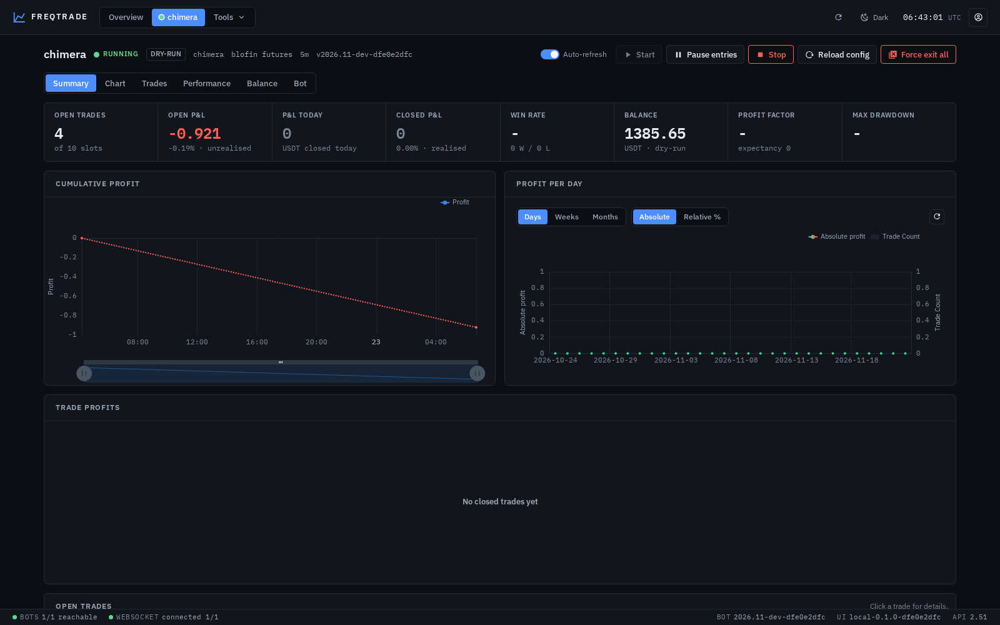
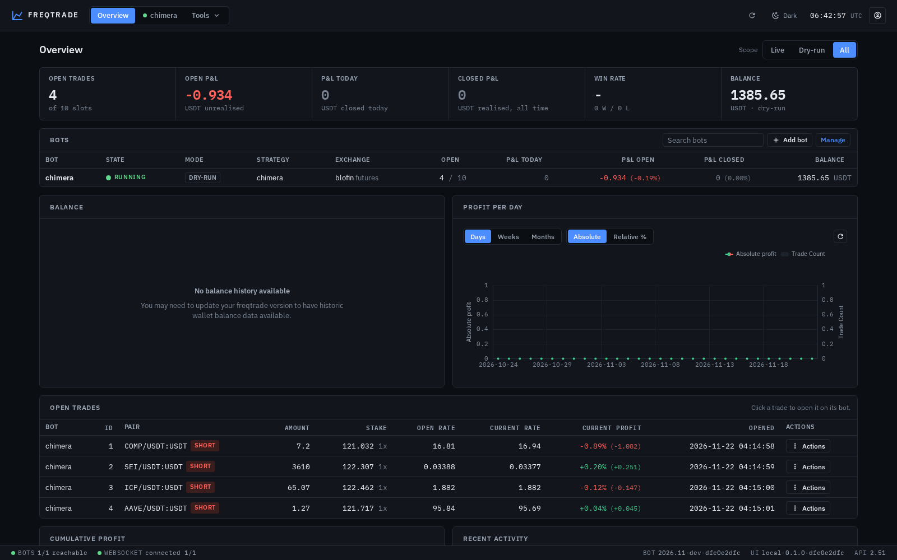
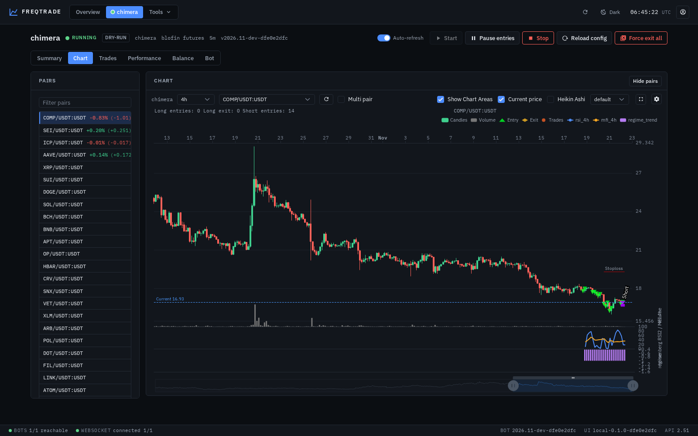
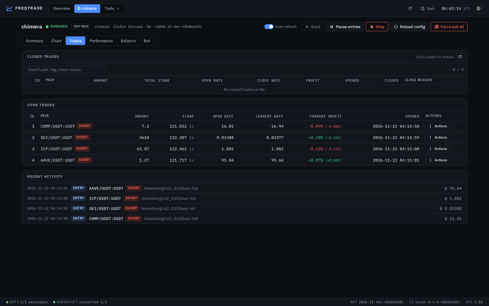
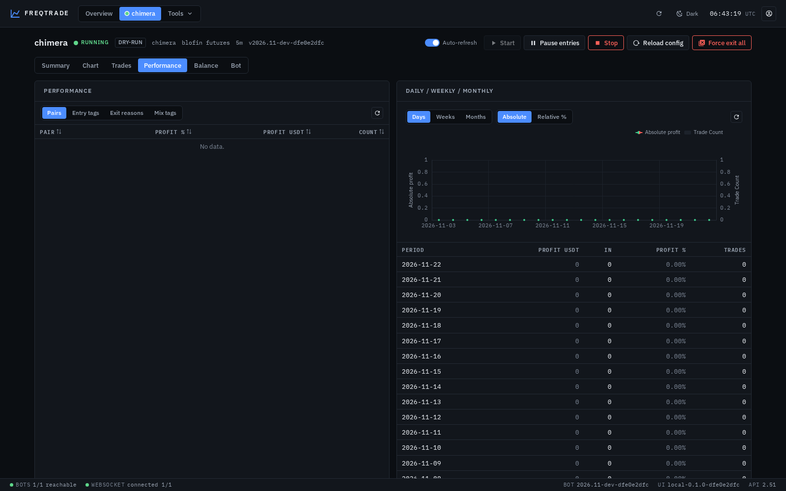
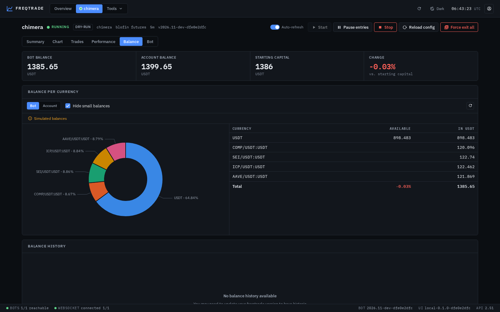
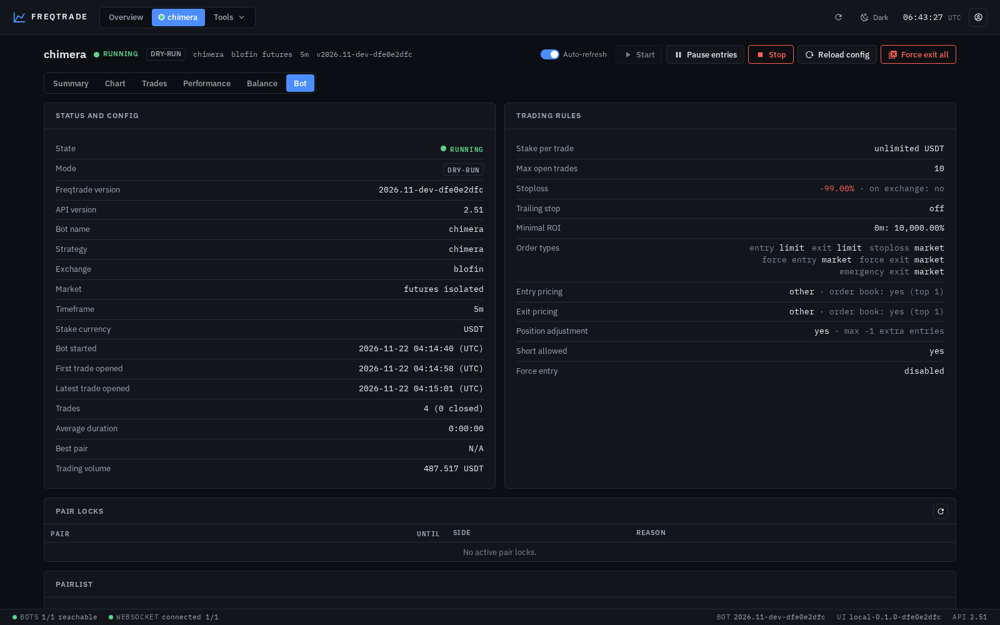
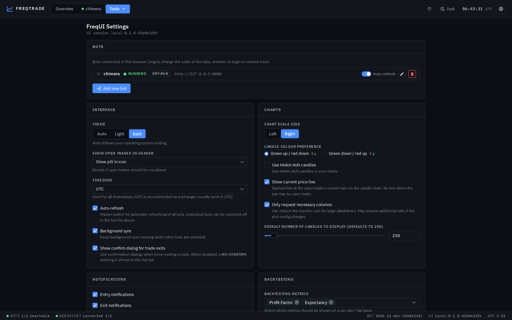

# FreqUI, redesigned

A reworked web interface for the [freqtrade](https://github.com/freqtrade/freqtrade) crypto trading bot. It started from [FreqUI](https://github.com/freqtrade/frequi) 2.2.5 (the official freqtrade UI, Vue 3 + PrimeVue) and is restyled around monitoring a running bot. It has a new layout, a reworked candle chart, more reliable live updates, and a set of bug fixes.

All freqtrade features of the original stay available. The stores and API calls are the original ones, so it talks to a normal freqtrade REST API.



## Screenshots

| Overview | Chart |
|---|---|
|  |  |
| **Trades** | **Performance** |
|  |  |
| **Balance** | **Bot** |
|  |  |
| **Settings** | |
|  | |

## What's changed compared to FreqUI

### Redesign

- **Design tokens.** One set of colours, spacing and type in `src/styles/tokens.css`, used by the PrimeVue preset and the chart theme.
- **Themes.** Dark (default) and light, with an auto / light / dark switch.
- **Look.** Slate panels with 1px borders, a blue accent, and a compact 13px density.
- **Fonts.** IBM Plex Sans and Mono are bundled, so the UI also works offline.
- **Top bar.** Overview, one tab per bot, and a Tools menu (Backtesting, Pairlist config, Download data, Logs, Settings).
- **Status bar.** Bot reachability, WebSocket state, and bot / UI / API versions.
- **Overview page.**
  - Live / dry-run scope filter and KPI tiles (open trades, open P&L, P&L today, closed P&L, win rate, balance).
  - Bots table, balance, profit per day, open trades across all bots, cumulative profit and recent activity.
- **Bot page (`/bot/<id>/<section>`).**
  - Sections: Summary, Chart, Trades, Performance, Balance and Bot (status, rules, locks, pairlist, log).
  - The bot controls sit in the header.
  - The draggable grids are replaced by responsive layouts.
- **Profit and safety.** Profit and loss always carry a sign. LIVE (amber) and DRY-RUN (grey) badges show the mode. Trading and destructive actions ask for confirmation.
- **Old links still work.** `/trade`, `/graph`, `/dashboard`, `/balance`, `/open_trades`, `/trade_history` and `/pairlist` redirect to the new pages.
- **FreqAI removed.** The FreqAI backtest option and the `/freqaimodels` call are gone.

### Candle chart

- **Timeframe selector.** In trade mode you can view a pair on any bigger timeframe that the bot's timeframe divides into, e.g. 15m, 1h, 4h or 1d on a 5m bot. The candles are grouped by the API (see [Backend](#backend)).
- **Per-pair default timeframe.** A strategy can name the timeframe each pair's chart opens on, with `plot_config.pair_timeframes`, e.g. `{"ATOM/USDT:USDT": "4h"}`.
- **Strategy plot config by default.** When you haven't set up a plot config yourself, the chart shows the one the strategy ships.
- **New tooltip.**
  - Shows every series at the hovered candle, grouped per subplot with its name, each with a dot in its line colour.
  - One date header per candle instead of one per subplot.
  - Rows without a value are left out.
  - Hardened so a bad value can't freeze the chart or hide the tooltip.
- **Current price line.** A dashed line at the open trade's current rate, with its value. You can switch it off in the chart toolbar and in Settings.
- **Fullscreen** button.

### Live updates and connection

- **Bot state updates right away.** Running / stopped / paused is pushed over the WebSocket, and also re-read every 5 s. Before, the state was refreshed at most once a minute, so a bot that stopped (for example after errors) could keep showing RUNNING.
- **Token refresh.**
  - Several requests that fail with 401 at the same moment now share one refresh.
  - The refresh has a timeout and always finishes, even when the reply has no token.
  - A failed refresh is reported as an error. Before, the original request resolved with nothing.
- **WebSocket reconnects with a fresh token.** Before, it reused the token from the first connect, which expires, so live updates silently stopped.
- **One WebSocket per bot.** Before, a reconnect could open a second socket, so every message arrived twice. Logging out now closes the socket.

### Fixes

- **Performance tab.** The *Profit %* column was empty for enter tags, exit reasons and mix tags, because the API only sends `profit_pct` for those.
- **Trade history.** Loading it no longer loops forever when the number of trades changes while it pages through them.
- **Chart tooltip.** The annotation (chart areas) series no longer adds empty rows to the tooltip. The tooltip offset follows the chart margins.
- **Force entry.** The stake field steps by 10 for USDC too, not only USDT.

### Force entry

- Shows the stake currency still available to the bot.
- Has a slider and 25 / 50 / 75 / 100 % quick-select buttons, plus *Default* to go back to the bot's configured stake amount.

Several of the fixes above are ports of later upstream FreqUI fixes (upstream has since moved to NuxtUI, so they were rewritten for this code base).

## Backend

Most of the UI works with a stock freqtrade API. Two chart features need API changes that stock freqtrade doesn't have yet:

- **Chart timeframe selector:** `pair_candles` groups the analyzed dataframe into the requested bigger timeframe.
- **Per-pair default timeframe:** the API passes the strategy's `plot_config.pair_timeframes` through to the UI.

## Install into freqtrade

```bash
pnpm install
pnpm run build
# Copy the build into freqtrade's UI folder (the same place `freqtrade install-ui` uses):
rm -rf <freqtrade>/freqtrade/rpc/api_server/ui/installed
cp -r dist <freqtrade>/freqtrade/rpc/api_server/ui/installed
```

Then restart freqtrade and open its API address in your browser. Each [release](../../releases) also has a ready-built `freqUI.zip` with the same content as `dist/`.

## Development

You need a freqtrade bot with the REST API enabled. Set [CORS](https://www.freqtrade.io/en/stable/rest-api/#cors) to allow `http://localhost:3000`.

```bash
pnpm install
pnpm run dev           # dev server on http://localhost:3000
pnpm run typecheck
pnpm run lint
pnpm run test:unit
pnpm run build         # production build in dist/
```

To run FreqUI on its own in Docker (built from this source): `docker compose up -d`, then open port 3000.

## Credits and license

Based on [FreqUI](https://github.com/freqtrade/frequi) by the freqtrade team. Like FreqUI, this project is licensed under the [GNU General Public License v3.0](LICENSE).
